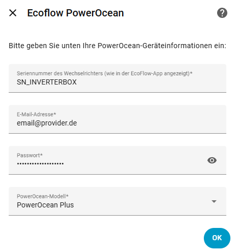

# PowerOcean Single Phase

[](https://github.com/hacs/integration)

A [Home Assistant](https://home-assistant.io/) integration for the EcoFlow PowerOcean Single Phase. It reads the values the EcoFlow cloud holds for your system and, over MQTT, changes a few settings and the app's scheduled tasks.

This integration is not made or supported by EcoFlow. It uses the EcoFlow cloud, not an official API.

## What you get

- Sensors for solar, grid, battery and house power, energy totals, the batteries, the smart meter and active errors.
- Calculated energy flows, such as solar to house and battery to house.
- With the optional MQTT connection: the EcoFlow app's scheduled tasks as switches, plus add, update and delete actions.
- Also with MQTT: sliders for LED brightness, backup reserve and surplus solar energy delivery, a battery save mode switch, firmware versions and faster power values.

## Install

You need Home Assistant 2025.8.0 or newer, the serial number of your inverter (shown in the EcoFlow app) and your EcoFlow account e-mail and password.

With HACS:

1. In HACS, open the menu (three dots) and choose Custom repositories.
2. Add `https://github.com/abz2much/powerocean_single_phase` with the type Integration.
3. Search for "PowerOcean Single Phase", download it and restart Home Assistant.
4. Go to Settings, Devices & services, Add integration, and pick PowerOcean Single Phase.

There is no release yet, so HACS installs the latest version of the main branch.

Without HACS, copy `custom_components/powerocean_single_phase` into the `custom_components` folder of your Home Assistant and restart.



## Scheduled tasks

Turn on the extended connection (MQTT) in the integration's options. Each schedule from the EcoFlow app then appears as a switch, and you can add, change and delete schedules from Home Assistant:

```yaml
action: powerocean_single_phase.add_schedule
data:
  device_id: <the inverter device>
  type: charge          # or use_battery
  power: 3000
  start: "02:00:00"
  end: "06:00:00"
  days: [mon, tue, wed, thu, fri]   # leave out for every day
```

You must set the option "Max schedule power (W)" first. Schedules may not overlap, and there can be at most six. Changing a schedule changes how your battery charges, so check the result in the EcoFlow app. The full rules are in [Scheduled tasks](docs/scheduled-tasks.md).

## Documentation

| Page | What is in it |
|---|---|
| [Scheduled tasks](docs/scheduled-tasks.md) | Switches, the Active schedule sensor, actions and rules |
| [Extended connection (MQTT)](docs/extended-connection.md) | Firmware, sliders, battery save mode and live power values |
| [Sensors and devices](docs/sensors-and-devices.md) | Entity IDs, attributes, active errors and each device |
| [Which values update](docs/data-freshness.md) | How often the cloud refreshes each value, and which to use |
| [Energy dashboard](docs/energy-dashboard.md) | Which sensors to use and how to fill the gaps |
| [Troubleshooting](docs/troubleshooting.md) | Diagnostics, login problems, debug logging, recording MQTT |
| [Changelog](CHANGELOG.md) | What changed in each version |

## Credits

This integration started as a copy of [niltrip/powerocean](https://github.com/niltrip/powerocean), which was inspired by [tolwi/hassio-ecoflow-cloud](https://github.com/tolwi/hassio-ecoflow-cloud) and is a copy of [evercape/hass-resol-KM2](https://github.com/evercape/hass-resol-KM2).

Thanks to [shuette42](https://github.com/shuette42) for [ecoflow-energy-ha](https://github.com/shuette42/ecoflow-energy-ha), whose protobuf definitions made the MQTT messages readable. Thanks to [Xygen](https://github.com/Xygen) for the diagnostics of a PowerGlow and a PowerPulse 2 and for the verified value mappings in his [PowerGlow](https://github.com/Xygen/EcoFlow-PowerGlow-for-Home-Assistant) and [PowerPulse 2](https://github.com/Xygen/EcoFlow-PowerPulse-2-for-Home-Assistant) integrations.

## Licence

PowerOcean Single Phase includes work originally created by niltrip and is distributed under the [MIT License](LICENSE).
