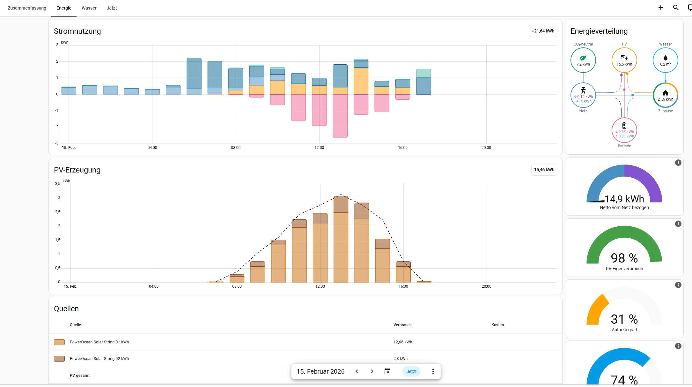

# Energy dashboard

The EcoFlow API reports energy counters only for some values. You can use these in the Energy dashboard as they are:

- Solar production: `totalElectricityGeneration`, shown as "Solar energy total" (kWh, changes about once an hour).
- Battery: `bpTotalChgEnergy` ("Battery charged energy") and `bpTotalDsgEnergy` ("Battery discharged energy").

There is no counter for the single PV strings and none for the grid.

## PV strings, or solar in finer steps

Turn the power into energy with an [integral sensor](https://www.home-assistant.io/integrations/integration/). Create it in the UI (Settings, Devices & services, Helpers, Integral sensor) or in YAML. [config/configuration.yaml](../config/configuration.yaml) has an example for all strings together and for each string.

## Grid import and export

Read your electricity meter locally, for example with a Tasmota reading head or a Shelly. The values then come straight from your network instead of through the EcoFlow cloud, and they match what the meter shows. The original author found that the grid values from the cloud did not match their meter, so they did not build an energy counter on them.

## Battery times

The same configuration file has template sensors for the remaining charge time, the remaining discharge time and the time the battery will be empty. Set the capacity and the backup reserve of your system there, and replace `SN` in the entity IDs with the serial number of your inverter in lowercase.

