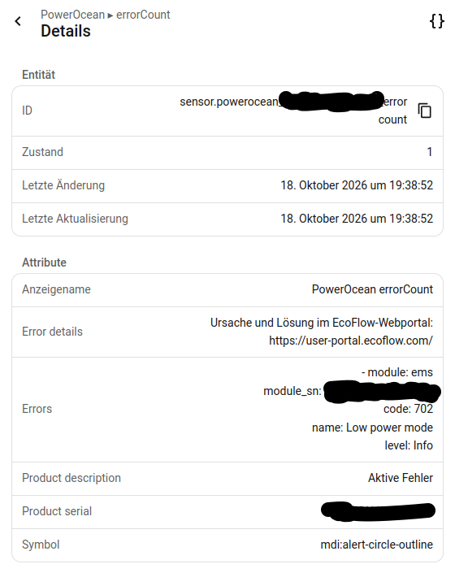
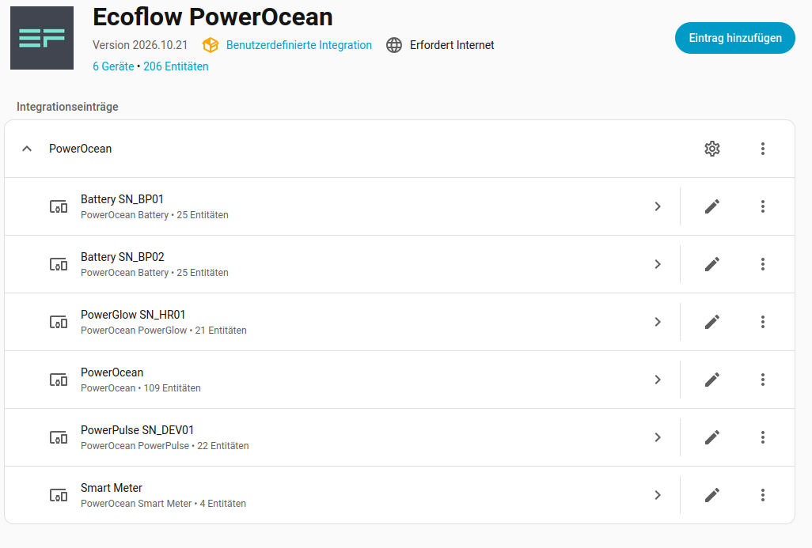
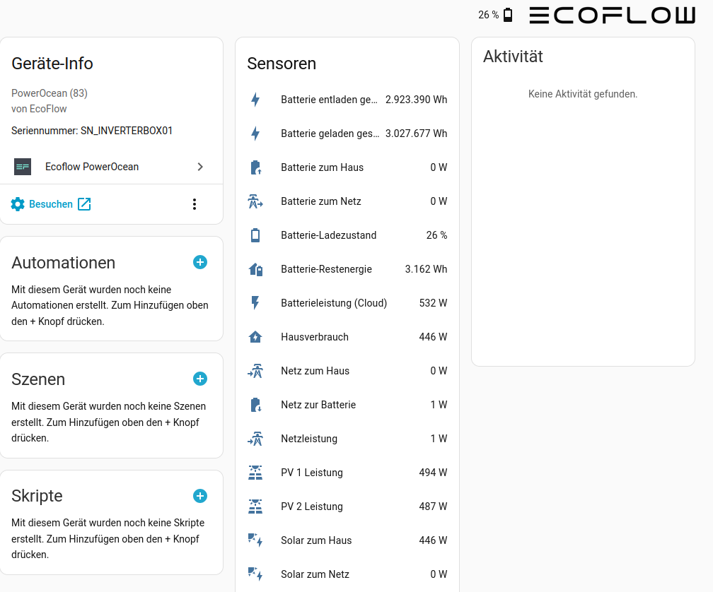
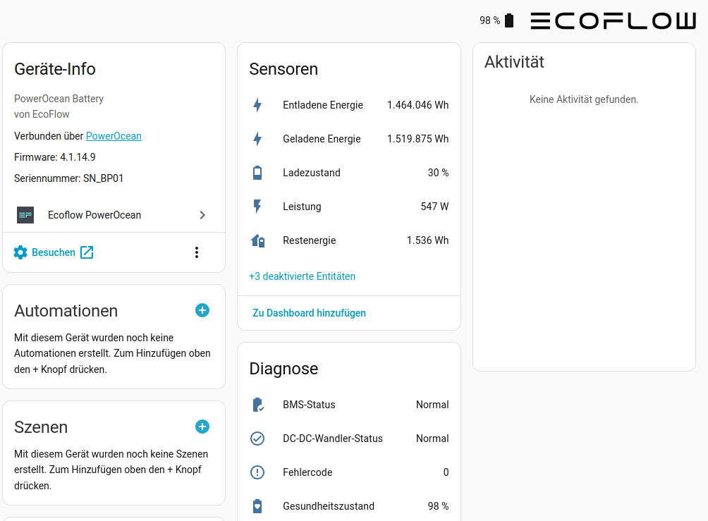
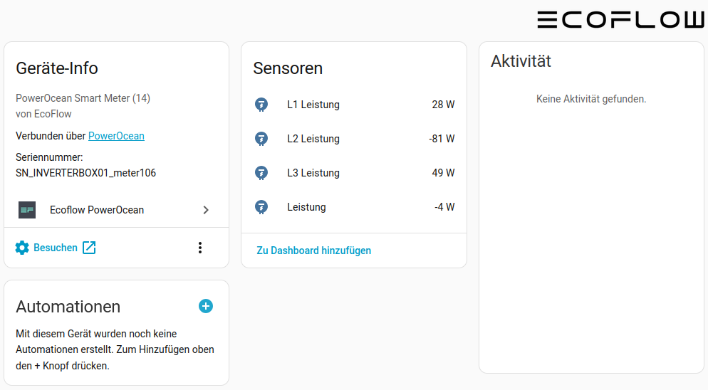
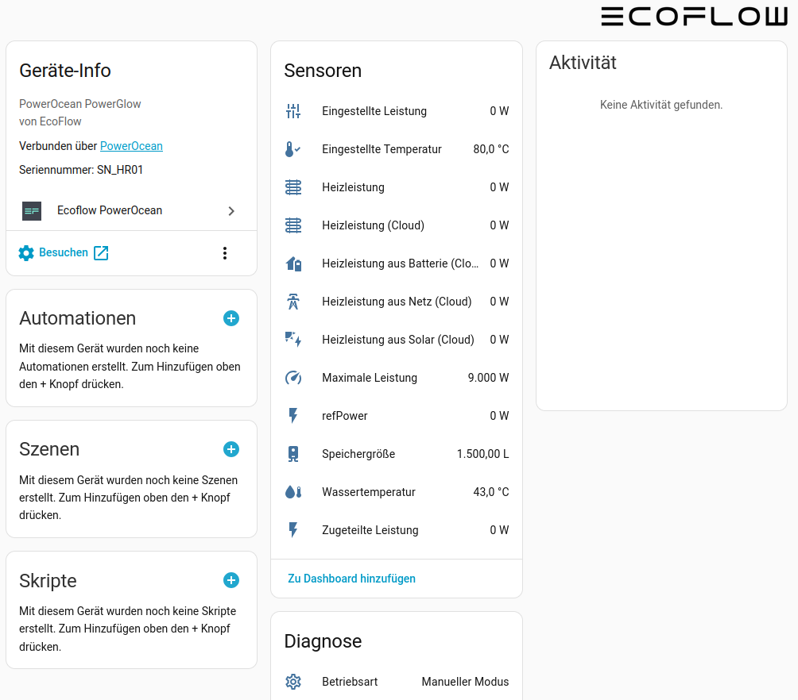
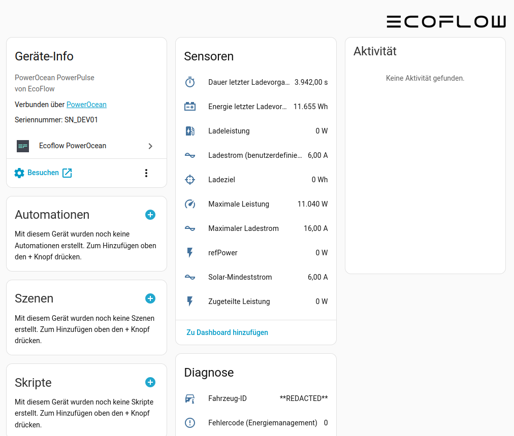

# Sensors and devices

## Sensors

Sensors are registered to their device as `sensor.{device_name}_{sensor_name}`. The `sensor_name` is the name of the value in the EcoFlow API, so the entity ID does not depend on the language. The friendly name is readable English, for example "State of charge" for `bpSoc`. Values whose meaning is not known yet keep `sensor_name` as their friendly name.

The unique ID is `{serial}_{report}_{sensor_name}`, for example `{serial}_JTS1_EMS_HEARTBEAT_pcsMeterPower`. Values outside a report use `{serial}_{sensor_name}`.

Each sensor has these attributes:

- `product_description`: what the value is, if known. Otherwise its name.
- `product_serial`: the serial number of the device the value belongs to.

## Active errors

The sensor `errorCount` ("Active errors") of each inverter counts the errors the system reports right now, as the app shows them. It covers the EMS, the inverter (PCS) and the battery packs.

Its attribute `errors` lists each active error with the module, the module's serial number and the error code. For known codes it also gives the name and level (Info, Warning or Error):

```yaml
errors:
  - module: ems
    module_sn: ...
    code: 521
    name: Energy storage communication error
    level: Warning
```

Cause and solution are only in the [EcoFlow web portal](https://user-portal.ecoflow.com/). The attribute `error_details` points there, and so does the Visit link on the device page.

Since Home Assistant 2026.2, the dialog of a sensor no longer lists its attributes. Open them with the three dots, then Details:



## Devices

Each part of the system is a device of its own, named by its serial number and linked to the inverter. The device info shows the serial number and, where the cloud reports it, the firmware. The Visit link opens the EcoFlow web portal.



### PowerOcean (inverter)

Live values, calculated energy flows and the state of the system. The model ID in brackets is the product type you chose at setup (83 is PowerOcean).



### Battery packs

State of charge, power, energy and state of health for each pack. The firmware is in the device info.



### Smart meter

Power of each phase and the total, for three-phase meters. The number in brackets is the meter type.



### PowerGlow heating rod and PowerPulse wallbox

If present: temperatures, heating power and mode for the heating rod, and charging power, currents, mode and the last charging session for the wallbox. Values marked "(cloud)" are probably only refreshed while the app is open, like the other cloud values described in [Which values update](data-freshness.md).




Apart from the settings described in [Extended connection](extended-connection.md) and [Scheduled tasks](scheduled-tasks.md), this integration only reads values. To control the PowerGlow or the PowerPulse 2 (mode, target temperature, charging current and so on), see the integrations by [Xygen](https://github.com/Xygen): [EcoFlow PowerGlow for Home Assistant](https://github.com/Xygen/EcoFlow-PowerGlow-for-Home-Assistant) and [EcoFlow PowerPulse 2 for Home Assistant](https://github.com/Xygen/EcoFlow-PowerPulse-2-for-Home-Assistant).
